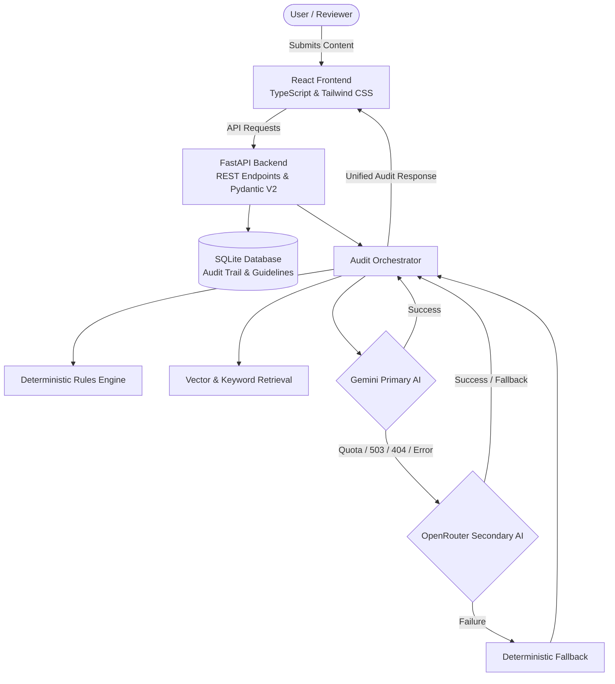

# BrandSentinel AI

**CodeNexus India 2026 — Round 2: The Build**

[](https://codenexus.com)
[](.)

---

## 🎯 Overview

**BrandSentinel AI** is an explainable, human-controlled brand governance platform that reviews organizational content against approved brand guidelines, product facts, terminology, messaging requirements, tone and voice standards.

### Key Features

✅ **Evidence-Linked Findings** — Every issue cites actual guideline sources  
✅ **Hybrid Audit Engine** — Deterministic rules + Gemini primary AI + OpenRouter secondary fallback  
✅ **Human-in-the-Loop Approval** — AI never makes final publication decisions  
✅ **Zero-Auth Judge Mode** — Functional in incognito without accounts  
✅ **Persistent Audit Trail** — SQLite-backed decision history  

---

## 🏗 Architecture



---

## 🚀 Quick Start

### Prerequisites

- **Python 3.11+**
- **Node.js 18+**
- **Google Gemini API Key** and/or **OpenRouter API Key**

### Backend Setup

```bash
cd backend
pip install -r requirements.txt
cp .env.example .env
# Edit .env and add your GEMINI_API_KEY and OPENROUTER_API_KEY
python -m uvicorn app.main:app --reload
```

Backend runs at: `http://localhost:8000`  
API Docs: `http://localhost:8000/docs`

### Frontend Setup

```bash
cd frontend
npm install
cp .env.example .env
npm run dev
```

Frontend runs at: `http://localhost:5173`

---

## 📦 Technology Stack

### Backend
- **FastAPI** — Modern Python web framework
- **Pydantic V2** — Data validation with type safety
- **SQLAlchemy** — ORM for SQLite persistence
- **Google Gemini API** — Primary AI contextual analysis (Gemini 3.8 Flash)
- **OpenRouter API** — Secondary AI fallback provider
- **NumPy** — Lightweight semantic retrieval

### Frontend
- **React 18** — UI library
- **TypeScript** — Type-safe development
- **Vite** — Fast build tool
- **Tailwind CSS** — Utility-first styling
- **Lucide React** — Clean icon system
- **Axios** — HTTP client

---

## 🎮 Usage Workflow

1. **Open Application** — No authentication required
2. **Load Brand Guidelines** — Pre-seeded ApexCloud guidelines available
3. **Submit Content** — Paste marketing copy or load sample drafts
4. **Run Audit** — Hybrid engine detects violations with primary/secondary AI failover
5. **Review Findings** — Each issue shows severity, explanation, evidence, and provider metadata
6. **Apply Corrections** — Accept or dismiss suggested replacements
7. **Human Approval** — Reviewer approves, rejects, or requests changes (with mandatory verification on incomplete AI checks)
8. **Audit History** — All decisions persisted and auditable

---

## 📁 Project Structure

```text
BrandSentinel AI/
├── backend/
│   ├── app/
│   │   ├── main.py                    # FastAPI app + routes
│   │   ├── schemas.py                 # Pydantic domain models
│   │   ├── models.py                  # SQLAlchemy ORM
│   │   ├── database.py                # Database configuration
│   │   ├── config.py                  # Environment settings
│   │   ├── seed_data.py               # ApexCloud guidelines
│   │   └── services/
│   │       ├── rules_engine.py        # Deterministic checks
│   │       ├── claim_extractor.py     # Unverified claim checks
│   │       ├── vector_store.py        # Keyword/semantic retrieval
│   │       ├── llm_auditor.py         # Gemini + OpenRouter failover
│   │       ├── upload_service.py      # Secure file processing
│   │       └── audit_orchestrator.py  # Merge + orchestration
│   ├── tests/
│   │   ├── test_audit.py              # Rule test suites
│   │   ├── test_missing_evidence.py   # Claim verification tests
│   │   └── test_llm_retries.py        # Retry & failover tests
│   ├── requirements.txt
│   └── .env.example
├── frontend/
│   ├── src/
│   │   ├── api/                       # Axios API client
│   │   ├── components/                # UI components (FindingsPanel, etc.)
│   │   ├── types/                     # TypeScript domain types
│   │   ├── App.tsx                    # Root application component
│   │   └── main.tsx                   # React entry point
│   ├── package.json
│   ├── tailwind.config.js
│   └── .env.example
├── workflow/
│   └── claude_code_master_build_plan.md
└── README.md
```

---

## 🔧 Environment Variables

### Backend (.env)
```env
GEMINI_API_KEY=your_gemini_api_key_here
GEMINI_MODEL=gemini-3.8-flash
OPENROUTER_API_KEY=your_openrouter_api_key_here
OPENROUTER_MODEL=google/gemma-4-31b-it:free
PORT=8000
CORS_ORIGINS="*"
DATABASE_URL=sqlite:///./brandsentinel.sqlite
```

### Frontend (.env)
```env
VITE_API_BASE_URL=http://localhost:8000
```

---

## 🧪 Testing

```bash
cd backend
python -m pytest tests/
```

---

## 🚢 Deployment

### Backend
- **Platform**: Render / Railway / Fly.io
- **Container**: Docker-ready
- **Database**: SQLite (upgradeable to PostgreSQL)

### Frontend
- **Platform**: Vercel / Netlify
- **Build**: `npm run build`
- **Output**: `dist/`

---

## 📝 License

MIT License — Built for CodeNexus India 2026

---

## 👥 Team

Built by a Principal Software Architect with Claude Code

---

## 🙏 Acknowledgments

- **Google Gemini & OpenRouter** — Multi-provider AI-powered contextual analysis
- **FastAPI** — Lightning-fast Python web framework
- **React** — Modern UI development
- **CodeNexus India 2026** — Hackathon organizers

---

